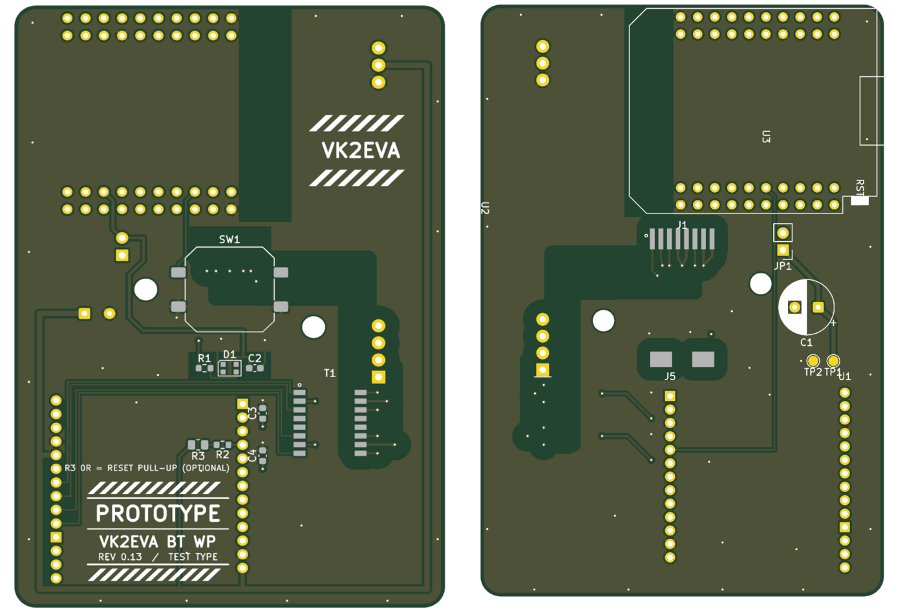

# Open BT Wallplate (A404)

A Bluetooth-to-network-audio wallplate for a Clipsal C2031VX plate.

- **Audiocom A404** module: Ethernet and network audio (AES67/Dante).
- **ESP32 MiniKit** (ESP-WROOM-32): Bluetooth Classic A2DP sink, sends stereo I²S to the A404.
- **R-Tone RT9400-3.3V**: isolated 3.3 V from 802.3af PoE.

**Status: rev 0.13, prototype draft.** Not yet built or tested. Read [release/r0.13/README.md](release/r0.13/README.md) for the check results and the open items before ordering boards.

## Layout

| Folder | Contents |
|---|---|
| `hardware/` | KiCad 10 project `dt-wp` (schematic, 4-layer PCB, custom DRC rules) and the `A404_Carrier` symbol and footprint libraries |
| `hardware/archive/` | Earlier 2-layer trial boards, kept for reference only |
| `release/r0.13/` | Gerbers, JLCPCB BOM and placement files, full BOM, ERC/DRC reports, render |
| `mechanical/fit-check/` | 1:1 printable dummy board (STL/3MF) for checking module footprints and wall fit |
| `firmware/` | ESP-IDF firmware for the ESP32 (to be added) |
| `docs/` | Design review log |

## Opening the project

Open `hardware/dt-wp.kicad_pro` in KiCad 10. The project-local library tables point at `A404_Carrier.kicad_sym` and `A404_Carrier.pretty` next to it.

## I²S wiring

| Signal | ESP32 | A404 |
|---|---|---|
| Bit clock | GPIO18 | J5.9 SCLK (A404 drives) |
| L/R clock | GPIO19 | J5.10 LRCLK (A404 drives) |
| Data | GPIO23 | J5.5 SDIN0 |

## Releases

Each hardware revision gets a folder under `release/` and a git tag (`hw-r0.13`). Change the KiCad files first, re-run ERC/DRC, then export a new release folder.

## Licence

No licence has been chosen yet.
